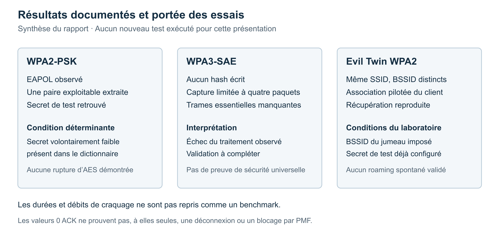

# Audit de sécurité Wi-Fi en laboratoire

Étude de WPA2-PSK, WPA3-SAE et d’un point d’accès jumeau dans un environnement Wi-Fi virtuel.

J’ai participé à ce projet de fin d’année pour comprendre ce que les échanges d’authentification Wi-Fi révèlent à un auditeur, et comment interpréter les résultats d’un test offensif. Le travail porte sur un laboratoire Kali Linux utilisant quatre radios virtuelles, sans point d’accès physique ni réseau tiers.

Les trois scénarios documentés sont la récupération d’un secret WPA2 de démonstration, une tentative de réutilisation du même traitement sur WPA3-SAE, puis une simulation Evil Twin. Cette présentation explique la démarche, les observations et les limites de chaque essai.

**Présentation du projet :** [Otmane Arajdal](https://github.com/xxxotmane) · **Contexte :** PFA de 4e année en Ingénierie des Réseaux et Cybersécurité · **Année universitaire :** 2025–2026.

[Synthèse publique du projet](docs/synthese-projet.pdf) · [Scénarios de validation](docs/scenarios-validation.md) · [Analyse des résultats](docs/analyse-resultats.md) · [Méthodologie](docs/methodologie.md)

## Questions étudiées

- Dans quelles conditions une capture WPA2-PSK permet-elle de vérifier des candidats hors ligne ?
- Le traitement utilisé pour WPA2 produit-il une entrée exploitable dans notre essai WPA3-SAE ?
- Que montre une simulation avec deux points d’accès partageant le même SSID ?
- Quelles conclusions restent valables lorsque la couche radio est simulée ?

## Architecture du laboratoire


Le module Linux `mac80211_hwsim` crée les radios de test. `hostapd` joue le rôle du point d’accès, `wpa_supplicant` celui du client. Les interfaces de surveillance observent les échanges. Les rôles de `wlan2` et `wlan3` dépendent du scénario : l’interface utilisée pour la surveillance peut être réaffectée au point d’accès jumeau.

| Interface de référence | Rôle documenté |
|---|---|
| `wlan0` | Point d’accès de test WPA2, puis WPA3 |
| `wlan1` | Client contrôlé |
| `wlan2` | Surveillance ou point d’accès jumeau selon l’essai |
| `wlan3` | Interface de capture dédiée |

Ce schéma est une représentation logique du laboratoire. Il ne reproduit pas la portée, les interférences ou la puissance d’un réseau radio réel.

## Outils utilisés

| Outil | Rôle dans le projet |
|---|---|
| Kali Linux et `mac80211_hwsim` | Environnement de simulation |
| `hostapd` | Configuration des points d’accès de test |
| `wpa_supplicant` | Association du client contrôlé |
| Aircrack-ng | Mode moniteur, observation des échanges et essais d’injection |
| `hcxpcapngtool` | Analyse et conversion des captures |
| Hashcat | Vérification hors ligne de candidats pour le cas WPA2 |

Les fichiers source des configurations, les captures réseau et les dictionnaires ne sont pas fournis dans ce dépôt. La documentation décrit les manipulations du rapport ; elle n’annonce pas un outil automatisé prêt à exécuter.

## Résultats des trois scénarios



| Scénario | Résultat documenté | Ce que l’on peut conclure |
|---|---|---|
| WPA2-PSK | Capture EAPOL, une paire convertie, récupération du secret de test avec le dictionnaire | Le secret faible, choisi pour la démonstration, figurait parmi les candidats. Aucune rupture du chiffrement AES n’est démontrée. |
| WPA3-SAE | Aucun hash écrit par le traitement utilisé ; Hashcat ne charge pas d’entrée | La capture analysée contient seulement quatre paquets et des avertissements de trames manquantes. Cet essai ne suffit pas à prouver la sécurité complète de WPA3. |
| Evil Twin WPA2 | Même SSID, BSSID distincts, association du client au jumeau, extraction EAPOL et récupération reproduite | L’association est pilotée par BSSID et le jumeau utilise le secret déjà connu du test. Aucun basculement spontané vers le signal le plus fort n’est validé. |

### WPA2 et qualité du secret

Le premier scénario illustre le lien entre le secret partagé et l’attaque par dictionnaire. Le chiffrement CCMP reste utilisé, mais la capture permet de vérifier des candidats compatibles avec WPA2-PSK. Le résultat tient à la présence du secret faible dans le dictionnaire. Il ne permet pas d’estimer le temps nécessaire pour retrouver un autre secret ni de classer tous les réseaux WPA2 comme facilement compromis.

### WPA3 et qualité de la preuve

SAE vise notamment à limiter la vérification passive de candidats hors ligne à partir d’un échange capturé. Ce principe cryptographique doit être distingué de notre résultat expérimental : le convertisseur n’a pas produit de hash, mais il signale aussi l’absence de trames essentielles dans la capture.

L’essai documente donc l’échec du traitement, avec une limite de qualité des données. Une comparaison plus concluante demanderait une capture complète, une confirmation des échanges SAE et une validation séparée de PMF. Les seules valeurs `0 ACK` ne permettent pas d’établir que PMF a bloqué les trames injectées.

### Evil Twin et conditions de l’essai

Un nom de réseau identique n’est pas une preuve d’identité du point d’accès. Dans la maquette, le client est explicitement dirigé vers le BSSID du jumeau et les paramètres de test sont connus. Ce scénario étudie les échanges obtenus dans ces conditions ; il ne démontre ni une compromission autonome d’un réseau inconnu, ni une interception complète du trafic.

## Recommandations et suites possibles

Les mesures proposées sont l’utilisation de WPA3-SAE lorsque le parc le permet, PMF obligatoire dans une configuration compatible, un secret unique à forte entropie si WPA2 reste nécessaire, la désactivation des fonctions WPS inutilisées et la mise à jour des équipements. Pour un environnement d’entreprise, la validation des certificats dans des profils EAP-TLS gérés mérite une étude dédiée.

La suite du travail serait de refaire la comparaison avec des captures complètes et un matériel Wi-Fi de test, puis de mesurer séparément le comportement d’association et la protection des trames de gestion. Les tests PMKID, Dragonblood, WPS/Pixie-Dust et la détection WIDS restent des perspectives ou des sujets théoriques, sans résultat pratique revendiqué ici.

## Documentation disponible

```text
wifi-security-audit-lab/
├── README.md
├── .gitignore
├── GITHUB_SETUP.md
├── assets/
│   ├── architecture.png
│   ├── architecture.svg
│   ├── resultats.png
│   └── resultats.svg
├── docs/
│   ├── synthese-projet.pdf
│   ├── architecture.md
│   ├── methodologie.md
│   ├── scenarios-validation.md
│   ├── analyse-resultats.md
│   └── sources-et-preuves.md
└── results/
    ├── observations.csv
    └── summary.json
```

Les visuels du dépôt sont des schémas et des tableaux de synthèse, pas des captures modifiées présentées comme originales. Le rapport et les captures intégrales restent hors du paquet public ; les secrets de test et les détails personnels ne sont pas nécessaires à cette présentation.

## Ce que je retiens

Ce PFA m’a permis de mieux relier les mécanismes d’authentification à leurs traces réseau. Il m’a aussi appris à examiner les conditions d’un test avant de conclure : un secret retrouvé, un fichier vide et une association forcée n’apportent pas la même preuve. Cette distinction est essentielle pour formuler des recommandations techniques proportionnées aux résultats.

## Références

- [Linux Wireless : mac80211_hwsim](https://wireless.docs.kernel.org/en/latest/en/users/drivers/mac80211_hwsim.html)
- [Hashcat : format WPA-PBKDF2-PMKID+EAPOL](https://hashcat.net/wiki/doku.php?id=cracking_wpawpa2)
- [Configuration de référence hostapd](https://chromium.googlesource.com/external/w1.fi/cgit/hostap/+/9c6b0a941672eb54e5a5e11f4d6a699f2aba1709/hostapd/hostapd.conf)
- [Dragonblood : travaux des auteurs sur WPA3](https://wpa3.mathyvanhoef.com/)
- [Traçabilité des observations](docs/sources-et-preuves.md)
