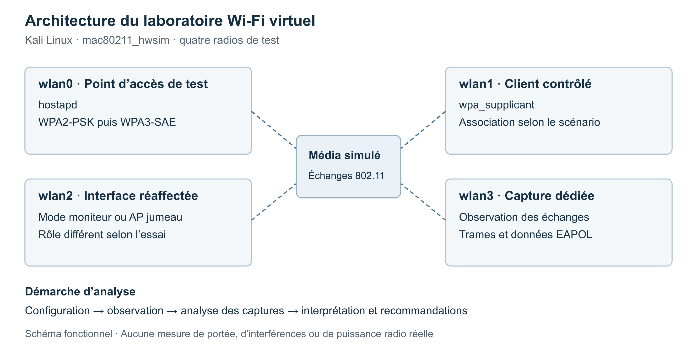

# Architecture du laboratoire

Le projet repose sur Kali Linux et `mac80211_hwsim`. Ce module du noyau Linux simule des radios IEEE 802.11 pour tester des outils comme hostapd et wpa_supplicant sans matériel Wi-Fi. Les quatre interfaces de la maquette ne représentent pas quatre adaptateurs radio physiques.

| Interface | Fonction décrite |
|---|---|
| wlan0 | Point d’accès légitime de test WPA2 puis WPA3 |
| wlan1 | Client contrôlé |
| wlan2 | Surveillance ou point d’accès jumeau selon le scénario |
| wlan3 | Capture dédiée, en mode moniteur |

Les interfaces de capture peuvent recevoir un nom suffixé par `mon`. Il faut vérifier les rôles actifs avant chaque manipulation, car une interface ne doit pas être présentée comme un AP et un moniteur indépendants simultanément sans préciser la configuration.

## Trois états successifs

1. **WPA2-PSK** : point d’accès et client de test, avec un secret faible choisi pour la démonstration.
2. **WPA3-SAE** : modification des paramètres de sécurité ; PMF est configuré comme obligatoire avec `ieee80211w=2` dans le rapport.
3. **Evil Twin** : deux AP de laboratoire partagent un SSID, avec des BSSID synthétiques distincts. Le profil du client impose l’association au jumeau.

Le dernier état n’implique pas une sélection automatique par puissance radio. La configuration du jumeau connaît déjà le secret de test. Le schéma résume les rôles et ne reproduit pas la portée, le comportement RF, l’ensemble des adresses ou les configurations complètes.

La capture de référence WPA3 présente aussi des trames manquantes. Une nouvelle validation devrait conserver les données de contrôle et d’authentification complètes avant de conclure sur le traitement d’un échange.

Référence : [Linux Wireless, mac80211_hwsim](https://wireless.docs.kernel.org/en/latest/en/users/drivers/mac80211_hwsim.html).
